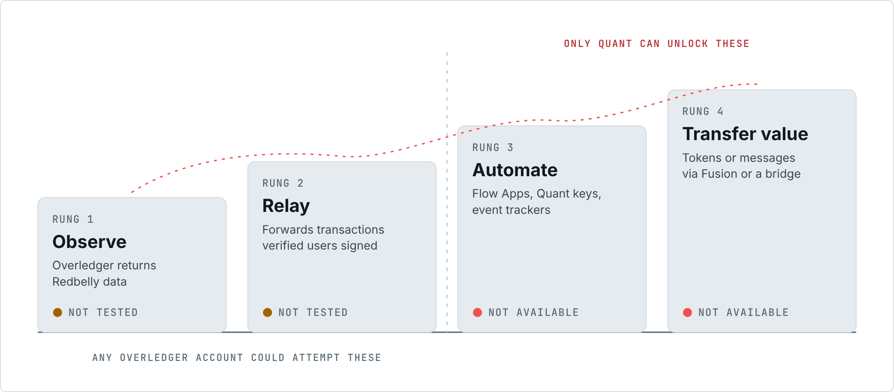
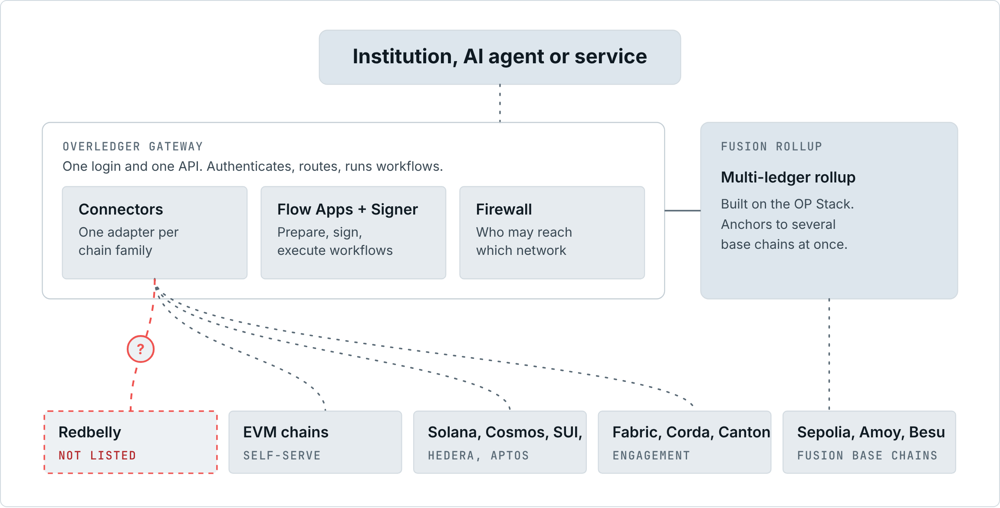
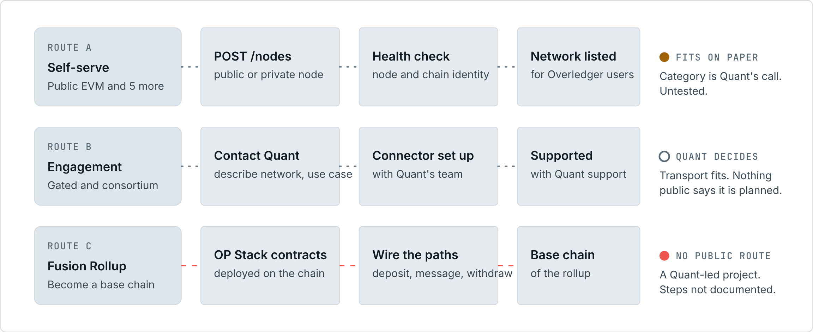
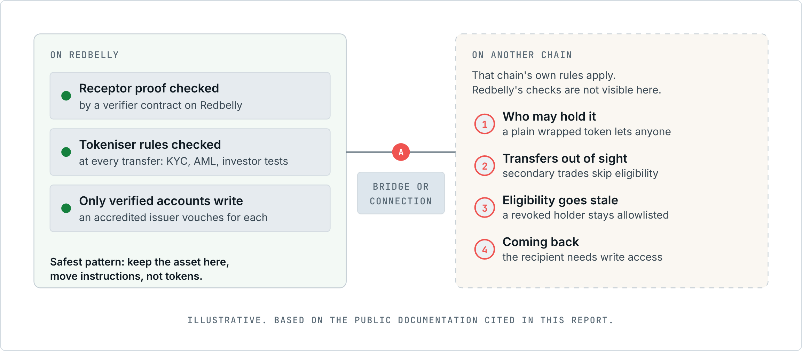

# Could Redbelly connect to Quant's Overledger?

*An evidence-first look at the technical fit, the work involved, the institutional value and the compliance risks of linking Redbelly Network to Overledger.*

TASK-29 submission, Redbelly DAO Community Task Board. Research cut-off 25 October 2026. Version 1.1.

## 1. Before you read

This document studies one question from public evidence: is a link between Redbelly Network and Quant's Overledger technically feasible, what would building it involve, and what would institutions on Redbelly gain or risk.

> **Notice**
>
> **Read this as research, not news.** No partnership or talks between Redbelly and Quant have been announced, and this document does not imply any [S48](https://taskboard.redbellydao.network/tasks/TASK-29). Redbelly has published no official stance on bridging either [S48](https://taskboard.redbellydao.network/tasks/TASK-29). Wherever no public source answers a point, we mark it as unknown instead of guessing.

Each finding carries one of three labels:

- **Confirmed** means a public source says it, and the citation chip beside the sentence links to that source. Results of the tests we ran ourselves also count as confirmed; they are labelled "live check" and link to raw output that anyone can regenerate.
- **Analysis** is our own reasoning from confirmed facts. Nobody at Redbelly, Quant or Tokeniser has said it.
- **Unknown** marks a gap that no public source fills.

Evidence was gathered up to 25 October 2026. Quant says Overledger keeps adding networks and points readers to its API for the current set [S07](https://docs.overledger.dev/docs/connectors), so some details here will date quickly. [What would change the answer](#signals) lists the things worth watching. There is no price talk and no investment advice here.

## 2. The verdict in sixty seconds

> **Confirmed**
>
> - Overledger has two doors for blockchains. Any account can plug in an open network from one of six supported families, EVM among them, with a single API request. Consortium, permissioned and operator-gated networks are onboarded in a project with Quant's team [S07](https://docs.overledger.dev/docs/connectors).
> - Redbelly runs the EVM at version Prague with Solidity v0.8.30 [S23](https://vine.redbelly.network/consensus/evm-compatibility/). It has a Mainnet (chain 151) and a Testnet (chain 153), each with a public RPC address [S21](https://vine.redbelly.network/environments/).
> - Reading Redbelly is open to all, but writing needs an identity. Before switching on write access, each user has to collect an access credential issued by an accredited issuer [S25](https://vine.redbelly.network/identity/). When we signed a transaction with a brand new key, both networks rejected it with "Sender not authorised to write transactions" [S49](evidence/live-checks.json).
> - None of the Overledger documentation we read mentions Redbelly [S05](https://docs.overledger.dev/docs/start-here) [S06](https://docs.overledger.dev/docs/overview) [S07](https://docs.overledger.dev/docs/connectors) [S11](https://docs.overledger.dev/docs/fusion-rollup), and Fusion Rollup did not include it among its first connected chains [S11](https://docs.overledger.dev/docs/fusion-rollup). Using an Overledger account, we pulled the live network list on 25 October 2026: it held 59 networks and Redbelly was not one of them by name, RPC host or chain ID [S50](evidence/overledger-account-checks.json).

> **Analysis**
>
> **Today there is no Redbelly connection on Overledger.** The smallest possible link would be an Overledger account pointing at a Redbelly RPC endpoint, so Overledger can read the chain and relay transactions that verified Redbelly users have already signed. On paper that looks achievable: Redbelly is EVM [S23](https://vine.redbelly.network/consensus/evm-compatibility/), Ankr already runs a Redbelly endpoint and sits on Overledger's list of approved providers [S07](https://docs.overledger.dev/docs/connectors) [S21](https://vine.redbelly.network/environments/), and accounts may add EVM networks Overledger has never seen [S07](https://docs.overledger.dev/docs/connectors). Nobody has tested it. The deciding factor belongs to Quant: whether a chain with open reads and gated writes, which Overledger's own glossary calls "public permissioned" [S06](https://docs.overledger.dev/docs/overview), may use the self-service door.
>
> Everything beyond that minimal link, including signing keys held by Quant, Overledger workflows and moving value through Fusion Rollup, cannot happen unless Quant adds Redbelly support. Separately, Redbelly's compliance rules stay on Redbelly. An asset copied to another chain leaves them behind unless the link is deliberately built to carry them.

### The connection ladder

"Connected" can mean very different things, so we split it into four rungs. Each rung needs more work and a different set of people.

| Rung | What a user would notice | Can it happen today? | Who holds the key to it |
|---|---|---|---|
| 1. Observe | Overledger shows Redbelly balances, blocks and contract state | **Plausible, not tested** | Any Overledger account, provided the node passes Overledger's health check [S07](https://docs.overledger.dev/docs/connectors) [S49](evidence/live-checks.json) |
| 2. Relay | Overledger forwards a Redbelly transaction that a verified user signed | **Plausible, not tested** | As rung 1, and every signer must already have Redbelly write access [S25](https://vine.redbelly.network/identity/) [S49](evidence/live-checks.json) |
| 3. Automate | Flow Apps, Quant custody keys and event trackers work on Redbelly | **Not available** | Quant, plus Redbelly-verified signing addresses [S09](https://docs.overledger.dev/docs/signing) [S12](https://docs.overledger.dev/docs/flow-apps) |
| 4. Transfer value | Tokens or messages cross between Redbelly and other chains via Overledger | **Not available** | Quant, through a Fusion Rollup or bridge project [S11](https://docs.overledger.dev/docs/fusion-rollup) |
| Listing | Redbelly shows up in Overledger's network list | **Absent** | Read with an account: 59 networks, no Redbelly [S50](evidence/overledger-account-checks.json) |
| Bank reach | Institutions on TCH's network can reach Redbelly assets | **Unknown** | TCH and its member banks; no ledgers or public chain links announced [S01](https://www.theclearinghouse.org/payment-systems/Articles/2026/09/The-Clearing-House-Partners-with-Quant-to-Advance-the--On-Chain-Money-Initiative) [S03](https://quant.network/news/quant-powers-the-clearing-houses-on-chain-money-initiative-in-the-us/) |
| Rules travel | Receptor and Tokeniser checks still apply once an asset leaves Redbelly | **Only by design** | Whoever designs the link (see [Compliance across chains](#compliance)) |

*Figure 1. The connection ladder: four rungs, and who can unlock each one.*

## 3. Where this question comes from

> **Confirmed**
>
> The Clearing House (TCH) announced on 24 September 2026 that it had chosen Quant to power its On-Chain Money Initiative, which it describes as "a new interoperable payments network that will enable financial institutions of all sizes to clear and settle tokenized deposit transactions" [S01](https://www.theclearinghouse.org/payment-systems/Articles/2026/09/The-Clearing-House-Partners-with-Quant-to-Advance-the--On-Chain-Money-Initiative). Quant's technology "will enable the network's interoperability, orchestration, and transaction-management layer", and the network will connect to existing rails such as RTP and CHIPS [S01](https://www.theclearinghouse.org/payment-systems/Articles/2026/09/The-Clearing-House-Partners-with-Quant-to-Advance-the--On-Chain-Money-Initiative) [S02](https://quant.network/press-releases/the-clearing-house-partners-with-quant-to-advance-the-on-chain-money-initiative/). TCH expects participating institutions to have access in the first half of 2027 [S01](https://www.theclearinghouse.org/payment-systems/Articles/2026/09/The-Clearing-House-Partners-with-Quant-to-Advance-the--On-Chain-Money-Initiative).
>
> TCH had first presented the initiative on 5 June 2026, as a project led by banks and operated by TCH [S04](https://www.theclearinghouse.org/payment-systems/Articles/2026/06/Major-Financial-Institutions-Unveil-Bank-Led-On-Chain-Money-Initiative). According to Quant, the choice followed a competitive process. Quant adds that US institutions clearing through TCH without tokenised deposits of their own will be able to use its Tokenised Deposits-as-a-Service offering [S03](https://quant.network/news/quant-powers-the-clearing-houses-on-chain-money-initiative-in-the-us/).

> **Analysis**
>
> The link to Redbelly is indirect. A large US bank network has picked Quant to sit between its members and their ledgers. Should Quant end up as common bank plumbing, chains its software already speaks to would sit closer to those banks. The community question grows out of that thought.
>
> Two gaps in the announcement deserve attention. The press texts speak of "Quant's technology" without naming a product [S01](https://www.theclearinghouse.org/payment-systems/Articles/2026/09/The-Clearing-House-Partners-with-Quant-to-Advance-the--On-Chain-Money-Initiative) [S02](https://quant.network/press-releases/the-clearing-house-partners-with-quant-to-advance-the-on-chain-money-initiative/) [S03](https://quant.network/news/quant-powers-the-clearing-houses-on-chain-money-initiative-in-the-us/). We study Overledger because the task names it and because its public documentation is the part of Quant's stack that explains how chains are attached [S05](https://docs.overledger.dev/docs/start-here). And the announcement says nothing about Redbelly, or about public blockchains in general.

> **Unknown**
>
> None of the four announcements names the ledgers underneath the bank network or mentions links to public blockchains [S01](https://www.theclearinghouse.org/payment-systems/Articles/2026/09/The-Clearing-House-Partners-with-Quant-to-Advance-the--On-Chain-Money-Initiative) [S02](https://quant.network/press-releases/the-clearing-house-partners-with-quant-to-advance-the-on-chain-money-initiative/) [S03](https://quant.network/news/quant-powers-the-clearing-houses-on-chain-money-initiative-in-the-us/) [S04](https://www.theclearinghouse.org/payment-systems/Articles/2026/06/Major-Financial-Institutions-Unveil-Bank-Led-On-Chain-Money-Initiative).

## 4. How Overledger works

A useful picture is an airport hub. Passengers check in once at the hub, and the hub routes each of them to the right airline. Overledger plays the hub for applications, and blockchains are the airlines.

> **Confirmed**
>
> Quant describes Overledger as a multi-DLT platform with "one set of credentials, one API surface, one execution environment that connects to many DLT networks" [S05](https://docs.overledger.dev/docs/start-here). Its main parts are:
>
> - **The Gateway**, the single entry point. It checks who is calling, sends each request to the right place and hosts higher-level workflows [S06](https://docs.overledger.dev/docs/overview).
> - **Connectors**, one per blockchain family, which "abstract individual DLT RPC protocols behind a common interface" [S06](https://docs.overledger.dev/docs/overview). Each one draws on a pool of nodes run by Quant and nodes added by customers [S06](https://docs.overledger.dev/docs/overview).
> - **Flow Apps**, typed multi-step sessions for jobs such as signing, deploying a contract, a compliance check or a payment [S05](https://docs.overledger.dev/docs/start-here). Flow Apps that touch a chain mostly use a Prepare, Sign, Execute sequence [S12](https://docs.overledger.dev/docs/flow-apps). Outside parties may host Flow Apps and register them [S05](https://docs.overledger.dev/docs/start-here) [S12](https://docs.overledger.dev/docs/flow-apps), although Quant states that every app it currently ships is internal [S12](https://docs.overledger.dev/docs/flow-apps).
> - **The Signer**. Customers either sign with their own keys or let Quant keep the keys, in a hot wallet on testnet or under contract in a KMS or HSM on mainnet. Private keys never pass through the Gateway [S09](https://docs.overledger.dev/docs/signing).
> - **The Overledger Firewall**, which works at two levels: off-chain it decides which users may reach which networks, and on-chain its Fusion Firewall component decides which addresses may call contracts, send messages between chains or bridge particular tokens [S10](https://docs.overledger.dev/docs/overledger-firewall).
> - **Fusion Rollup**, an OP Stack based rollup that settles to several base chains at the same time and offers one EVM environment over all of them [S11](https://docs.overledger.dev/docs/fusion-rollup).
> - **Quant Connect**, the web portal for opening an account and creating API keys [S08](https://docs.overledger.dev/docs/authentication).
>
> The API can also watch a contract event on a given network and post the result to a callback URL [S14](https://docs.overledger.dev/reference/subscribeevent), and Flow Apps send signed webhooks [S12](https://docs.overledger.dev/docs/flow-apps).

*Figure 2. How Overledger is put together, from its public documentation. Redbelly is not a listed network.*

### The three doors into Overledger

> **Confirmed**
>
> The Connectors chapter sets out two onboarding paths, and Fusion Rollup forms a third, separate route [S07](https://docs.overledger.dev/docs/connectors) [S11](https://docs.overledger.dev/docs/fusion-rollup).
>
> **Door 1, self-service.** The supported families are EVM, Solana, Cosmos, SUI, Hedera and Aptos, and the door is meant for open networks without membership rules [S07](https://docs.overledger.dev/docs/connectors). Quant names three tests a family must pass: "(a) its nodes expose RPC or REST over HTTPS, (b) the RPC requires no security factor beyond an API key, and (c) node identity does not matter to other tenants" [S07](https://docs.overledger.dev/docs/connectors). An account may attach a node to a network Overledger already knows, or bring a network it does not know yet, if the family qualifies. In Quant's words, "The first POST /nodes call registers both the network and your node for it. This new network will then be available for Overledger users" [S07](https://docs.overledger.dev/docs/connectors).
>
> Each node is either shared or kept to the account. A shared (public) node joins the common pool, must be hosted by an approved provider and must embed that provider's API key in its URL; ankr.com is one of the approved domains [S07](https://docs.overledger.dev/docs/connectors) [S13](https://docs.overledger.dev/reference/post_nodes). A private node may sit on any domain and serves only the account that added it [S07](https://docs.overledger.dev/docs/connectors). All nodes go through a health check when they are added [S07](https://docs.overledger.dev/docs/connectors).
>
> **Door 2, engagement.** Quant reserves this for networks "where node identity matters, typically permissioned DLTs used by regulated consortia and operator-gated public chains" [S07](https://docs.overledger.dev/docs/connectors). Quant lists Fabric, Corda, Canton, permissioned Besu and Quorum among them, and adds that a network offering RPC over HTTPS "and authenticates with a bearer or API-key factor, Quant can normally onboard it" [S07](https://docs.overledger.dev/docs/connectors). A completely new family needs a "DLT checker (health validation + chain identifer lookup)", which Quant puts at around two days of work plus about a day per app that must handle it [S07](https://docs.overledger.dev/docs/connectors).
>
> Some rules hold for every path. Administrative methods such as `personal_*`, `admin_*` and `txpool_*` are blocked at the Gateway on EVM [S07](https://docs.overledger.dev/docs/connectors). Every network is public, permissioned (open to users the owner grants) or private [S07](https://docs.overledger.dev/docs/connectors). To choose a node, the Gateway favours the caller's private nodes and then weighs latency, error rates and QNT staked on each node [S07](https://docs.overledger.dev/docs/connectors). The current network list is served by `GET /networks` [S07](https://docs.overledger.dev/docs/connectors).
>
> **Door 3, Fusion Rollup.** The rollup keeps its own list of base chains. At testnet launch these were Ethereum Sepolia, Polygon Amoy and Quant's own permissioned Besu testnet [S11](https://docs.overledger.dev/docs/fusion-rollup). Each base chain carries "Standard OP Stack contracts, one deployment per chain" [S11](https://docs.overledger.dev/docs/fusion-rollup).

*Figure 3. The three documented ways a chain reaches Overledger, and how Redbelly fits each one.*

> **Unknown**
>
> The pages we read describe which chains Fusion was launched with, but give no self-service procedure for adding another base chain [S11](https://docs.overledger.dev/docs/fusion-rollup).

## 5. Redbelly's profile

> **Confirmed**
>
> - **Positioning.** Redbelly's documentation calls it "a layer 1 blockchain, built and optimised for real world asset tokenisation" [S15](https://docs.redbelly.network/).
> - **Execution.** Redbelly "can execute smart contracts written for the EVM", and its portal pins EVM version Prague and Solidity v0.8.30 [S23](https://vine.redbelly.network/consensus/evm-compatibility/).
> - **Access points.** Mainnet uses chain ID 151 and the RPC host `governors.mainnet.redbelly.network`; Testnet uses chain ID 153 [S21](https://vine.redbelly.network/environments/). The portal also names two third-party Mainnet endpoints: Ankr at `rpc.ankr.com/redbelly_mainnet`, and Uniblock, which expects an API key in a header [S21](https://vine.redbelly.network/environments/).
> - **Consensus.** DBFT has no leader, withstands faults while t < n/3, settles transactions deterministically "in a matter of seconds", and Redbelly states that the chain "cannot fork" [S22](https://vine.redbelly.network/consensus/).
> - **Fees.** Each unit of gas costs a fixed US dollar amount, converted at execution time by an on-chain oracle [S24](https://vine.redbelly.network/network-fees/).
> - **Identity.** Every participant must prove who they are before getting access [S25](https://vine.redbelly.network/identity/). A user shows a passport, verified by biometrics, to an accredited issuer and then turns on write access "through a specific network smart contract" [S26](https://vine.redbelly.network/identity/user-access/). The accredited issuers sit in an on-chain registry [S27](https://vine.redbelly.network/identity/accredited-issuers/). Redbelly's access app names Averer as the issuer; one verified person can link several accounts, and Testnet access is offered once verification is done [S30](https://access.redbelly.network/). A community builder reports that Mainnet and Testnet approvals are granted separately [S46](https://github.com/tycayomide/redbelly-testnet-bridge/blob/main/ARTICLE.md).
> - **Organisations.** A business proves incorporation to an accredited issuer [S29](https://vine.redbelly.network/business-verification/), after at least one officeholder has onboarded as an individual [S27](https://vine.redbelly.network/identity/accredited-issuers/).
> - **Consensus nodes.** Running one requires two accounts with network access and acceptance into the operator programme, which is not taking applications at the moment [S31](https://vine.redbelly.network/nodes/become-operator/).

### Bridges Redbelly already uses

> **Confirmed**
>
> - **LayerZero.** LayerZero V2 lists a Redbelly Mainnet deployment [S38](https://docs.layerzero.network/v2/deployments/deployed-contracts), and Redbelly's portal lists tokens that move over LayerZero via Stargate, among them RBNT, USD₮0, AUDF and WETH [S33](https://vine.redbelly.network/bridged-tokens/layerzero/).
> - **Lucid Labs**, built on Polymer and LayerZero [S34](https://vine.redbelly.network/bridged-tokens/lucidlabs/), is the tool Redbelly's portal recommends for bringing RBNT back to Redbelly from elsewhere [S32](https://vine.redbelly.network/native-currency/).
> - **Celer cBridge** uses a pegged model between Ethereum, BNB Chain and Redbelly [S36](https://blog.celer.network/2025/08/01/celer-announces-cbridge-support-for-redbelly/). Celer's post shows USDT, USDC, WBTC and ETH flowing into Redbelly and RBNT flowing out [S36](https://blog.celer.network/2025/08/01/celer-announces-cbridge-support-for-redbelly/). According to Redbelly's portal, Celer moves RBNT one way only: it "bridges out from Redbelly to Ethereum and BNB Chain, not back" [S35](https://vine.redbelly.network/bridged-tokens/celer/).
> - **Wrapped RBNT on Ethereum.** Redbelly published `0xb45ffb51984d626ee758b336c61cf20990c6bf13` as the official Wrapped RBNT contract on Ethereum [S37](https://x.com/RedbellyNetwork/status/1890340030197166112), and its portal lists that address in the Lucid Labs table [S34](https://vine.redbelly.network/bridged-tokens/lucidlabs/). Celer's Ethereum token for wrapped RBNT is a separate contract, `0x063a1D5BFEAb213c9c12f47b704fccf81D60983e` [S35](https://vine.redbelly.network/bridged-tokens/celer/).
> - **DAO work.** The selected TASK-08 entry built a testnet bridge that locks ETH on Sepolia and mints on Redbelly Testnet, secured by two of three relayers [S44](https://github.com/Redbelly-DAO-Community-Taskboard/TASK-08-bridge-integration-guide), with a working demo [S45](https://redbridge.test-hub.xyz/). The selected TASK-16 entry is a recovery guide for RBNT stuck between chains [S47](https://github.com/Redbelly-DAO-Community-Taskboard/TASK-16-cross-chain-recovery-playbook).

> **Analysis**
>
> Two observations shape the rest of this study.
>
> The first is technical familiarity. Redbelly speaks EVM, the family with the widest self-service support on Overledger, and several unrelated bridge providers already run on it. That proves outside infrastructure can work with Redbelly's EVM. It proves nothing about Overledger in particular.
>
> The second is Redbelly's access model. Anyone can read the chain, but only verified identities can write. Overledger's documentation divides networks into open ones that use self-service and gated ones that go through engagement [S07](https://docs.overledger.dev/docs/connectors). Redbelly falls between the two, and Overledger's glossary happens to name its exact model, "public permissioned", defined as "anyone can read but only allowlisted parties can write" [S06](https://docs.overledger.dev/docs/overview). How Quant files Redbelly is the first question any attempt would hit.
>
> One more detail stands out. Ethereum already hosts at least two different wrapped RBNT tokens issued by different bridges [S34](https://vine.redbelly.network/bridged-tokens/lucidlabs/) [S35](https://vine.redbelly.network/bridged-tokens/celer/). Fusion's "Unify" feature was designed to "merge multiple chain-specific representations of the same underlying asset into a single rollup balance" [S11](https://docs.overledger.dev/docs/fusion-rollup). In principle that fits Redbelly's situation, but adding tokens to Fusion needs sign-off from Quant's governance [S10](https://docs.overledger.dev/docs/overledger-firewall).

## 6. Field tests without an account

Documentation can drift from reality, so we tested whatever could be tested without credentials. Every call only reads, except one transaction that is meant to fail. The code is in `scripts/probe.mjs`, the raw output in `evidence/live-checks.json`, and `npm run probe` repeats the whole run.

> **Confirmed by live check**
>
> | What we sent, 25 October 2026 | What came back | Why it is relevant |
> |---|---|---|
> | `eth_chainId` to Redbelly Mainnet, Testnet and the Ankr endpoint | 151, 153 and 151 [S49](evidence/live-checks.json) | Plain EVM JSON-RPC over HTTPS works on all three, which is self-service test (a). |
> | A call to Ankr without any API key | Normal answer [S49](evidence/live-checks.json) | Ankr is an approved provider [S07](https://docs.overledger.dev/docs/connectors) that serves Redbelly Mainnet [S21](https://vine.redbelly.network/environments/). A shared node also needs a key in its URL; we did not test a keyed URL. |
> | `net_version` to Mainnet | Rejected as unavailable, code -32601 [S49](evidence/live-checks.json) | Quant's docs keep this method "for wallets and tools that predate eth_chainId" [S11](https://docs.overledger.dev/docs/fusion-rollup). They do not reveal what the EVM health check calls. |
> | `eth_syncing`, `eth_gasPrice`, `eth_feeHistory`, `eth_maxPriorityFeePerGas` | All returned values [S49](evidence/live-checks.json) | Ordinary status and fee queries behave normally. |
> | Block tag `finalized` | Equal to the newest block [S49](evidence/live-checks.json) | Fits deterministic finality [S22](https://vine.redbelly.network/consensus/). |
> | Block tag `safe` | 3,663 blocks older than `finalized` [S49](evidence/live-checks.json) | Odd. Anything waiting on `safe` sees stale data. No documentation explains it. |
> | A zero-value transaction signed by a fresh, unverified key | Rejected on both networks: "Sender not authorised to write transactions" [S49](evidence/live-checks.json) | The identity gate is enforced at the RPC, as a community builder also reported [S46](https://github.com/tycayomide/redbelly-testnet-bridge/blob/main/ARTICLE.md). |
> | Gas estimate for that same key | Returned an estimate [S49](evidence/live-checks.json) | A workflow could get through "prepare" and only fail at "execute". |
> | Code at Permit2's usual address | None [S49](evidence/live-checks.json) | Overledger's x402 payment gates depend on Permit2 on EVM [S12](https://docs.overledger.dev/docs/flow-apps). |
> | Code at the Multicall3 and CREATE2 deployer addresses | Present [S49](evidence/live-checks.json) | Tools that expect these helpers at their usual addresses will find them. |
> | Overledger `GET /health` | HTTP 200, no login needed [S49](evidence/live-checks.json) | The gateway named in the docs is up. |
> | Overledger `GET /networks` and `/networks/fusion` | HTTP 401 without login [S49](evidence/live-checks.json) | The list is closed to the public; we read it with an account in the next section. |

## 7. Tests with an Overledger account

Some questions can only be answered by someone holding the right access. We split them into three stages inside one script, `npm run probe:account`.

> **Confirmed**
>
> - **The network list sits behind a login.** It comes from `GET /networks` [S07](https://docs.overledger.dev/docs/connectors), which returns HTTP 401 to anonymous callers [S49](evidence/live-checks.json). Accounts and API keys are issued through Quant Connect [S08](https://docs.overledger.dev/docs/authentication).
> - **Adding a node may publish a network.** When a network is new to Overledger, "the first POST /nodes call registers both the network and your node for it" and the network "will then be available for Overledger users" [S07](https://docs.overledger.dev/docs/connectors). The API reference for `POST /nodes` covers the node URL, network, name and family, and sets out the rules for shared nodes [S13](https://docs.overledger.dev/reference/post_nodes); the choice between shared and private is described for the Quant Connect form [S07](https://docs.overledger.dev/docs/connectors).
> - **A real Redbelly transaction needs a verified signer**, meaning a passport and biometric check with the accredited issuer Averer before write access is switched on [S26](https://vine.redbelly.network/identity/user-access/) [S30](https://access.redbelly.network/).

> **Analysis**
>
> Because of the second point, we chose not to register Redbelly as a shared network: other Overledger users would see the entry, and it could be taken for a listing. The script respects that line. Stage 1 only reads. Stage 2 works on Redbelly Testnet, prefers a node set to private in Quant Connect, and removes the node when finished. Stage 3 sends a single zero-value transfer from the operator's own verified Testnet address. No API key or private key is ever written to disk.

> **Confirmed by live check**
>
> Run on 25 October 2026 through `https://fusion-rollup.quant.dev`, covering stage 1 (read-only). 4 of 4 graded checks behaved as expected [S50](evidence/overledger-account-checks.json).
>
> | Stage | Check | Result | What it shows |
> |---|---|---|---|
> | 1 | API key authenticates | **As expected** | The key is valid. The user id itself is not stored. [S50](evidence/overledger-account-checks.json) |
> | 1 | Live network list: 59 networks visible to this account | **As expected** | The live list that the documentation points to. Visibility rules mean another account may see a different list. [S50](evidence/overledger-account-checks.json) |
> | 1 | Redbelly does not appear in the live network list | **Observed** | Redbelly is not a listed network for this account on this date. [S50](evidence/overledger-account-checks.json) |
> | 1 | Fusion Rollup connected networks | **As expected** | Shows which base chains the rollup is connected to today. [S50](evidence/overledger-account-checks.json) |
> | 1 | Nodes registered by this account | **As expected** | Baseline before any node test. [S50](evidence/overledger-account-checks.json) |

> **Confirmed**
>
> - **Size and mix.** The account could see 59 networks: 54 EVM, plus one each of Solana, SUI, Aptos, Hedera and Canton [S50](evidence/overledger-account-checks.json). Five of the six self-service families from the documentation are represented; there was no Cosmos network [S07](https://docs.overledger.dev/docs/connectors) [S50](evidence/overledger-account-checks.json).
> - **Almost all test networks.** Other than Quant's permissioned Canton network, every entry is a test network, for example Ethereum Sepolia, Base Sepolia and Avalanche Fuji, and the gateway the documentation names is itself a testnet environment [S50](evidence/overledger-account-checks.json).
> - **Redbelly absent.** A search of every field in every entry for "redbelly", "rbnt", Redbelly's RPC host and chain IDs 151, 152 and 153 returned nothing [S50](evidence/overledger-account-checks.json).
> - **Fusion today.** The rollup reports three connected networks: Quant Private Network (chain 7695), Ethereum Sepolia and Amoy [S50](evidence/overledger-account-checks.json), three base chains as in the documentation [S11](https://docs.overledger.dev/docs/fusion-rollup).
> - **Live field names.** Entries use `displayName` and `dltType`, while the documented model calls these fields `name` and `type` [S07](https://docs.overledger.dev/docs/connectors) [S50](evidence/overledger-account-checks.json).

> **Analysis**
>
> The EVM networks Overledger already serves on testnet are a varied group, from rollups like zkSync, Scroll and Linea to standalone chains like Avalanche, Sei and Monad [S50](evidence/overledger-account-checks.json). That variety makes it more likely, though not certain, that an EVM chain with Redbelly's quirks would pass the checker. The list covers testnet only and tells us nothing about Overledger's mainnet. A stage 2 run would settle the health check question; we held back because registering a new network on the shared gateway can create an entry that others see [S07](https://docs.overledger.dev/docs/connectors).

## 8. Door by door: can Redbelly get in today?

Below, each Overledger route is held up against Redbelly's documentation and our test results.

### Door 1: the self-service tests

| Overledger's condition [S07](https://docs.overledger.dev/docs/connectors) | Evidence from Redbelly | Our call |
|---|---|---|
| (a) HTTPS RPC | Mainnet and Testnet publish HTTPS endpoints [S21](https://vine.redbelly.network/environments/) that answered our calls [S49](evidence/live-checks.json) | **Satisfied** |
| (b) Nothing beyond an API key at the RPC | Reads need no key on the governor or Ankr endpoints [S49](evidence/live-checks.json); the write gate checks the signer of a transaction, not the connection [S25](https://vine.redbelly.network/identity/) [S49](evidence/live-checks.json) | **Satisfied at the RPC; signers gated** |
| (c) Nodes interchangeable for tenants | Every endpoint returns the same chain state, since the gate is on the signer [S25](https://vine.redbelly.network/identity/) [S49](evidence/live-checks.json) | **Looks satisfied; Quant decides** |
| Network is open and permissionless | Reads open, writes gated, a model Overledger itself calls "public permissioned" [S06](https://docs.overledger.dev/docs/overview), while its engagement path names "operator-gated public chains" [S07](https://docs.overledger.dev/docs/connectors) | **Quant decides** |

> **Analysis**
>
> Measured against the written tests alone, Redbelly appears to qualify. The sticking point is labelling. Self-service is presented as the path for open, permissionless networks [S07](https://docs.overledger.dev/docs/connectors), and Redbelly's write gate is the sort of feature that could steer Quant toward the engagement path instead. Only Quant can make that call; the Redbelly community cannot.

### Door 1: attaching a node

> **Confirmed**
>
> - Self-service accepts networks Overledger has not listed yet, as long as the family is supported, and EVM is [S07](https://docs.overledger.dev/docs/connectors).
> - A shared node must be hosted on an approved domain with an API key in its path; ankr.com qualifies [S07](https://docs.overledger.dev/docs/connectors) [S13](https://docs.overledger.dev/reference/post_nodes), and Redbelly's portal publishes an Ankr Mainnet endpoint [S21](https://vine.redbelly.network/environments/).
> - A private node may live on any HTTPS domain and serves only the account that added it [S07](https://docs.overledger.dev/docs/connectors).

> **Analysis**
>
> Two ways in appear possible on paper.
>
> - **Private node.** An account adds Redbelly's own RPC address as a private node, visible to that account alone. This is the easiest option and would give that account rung 1 (observe), and rung 2 (relay) for transactions already signed by a verified Redbelly user.
> - **Shared node.** An account adds a keyed Ankr address for Redbelly as a shared node. If Overledger accepted it, the same call would create the Redbelly network entry for every Overledger user [S07](https://docs.overledger.dev/docs/connectors).
>
> In both cases the write gate stays with Redbelly. Overledger would only deliver the transaction; Redbelly would still decide whether the signer may write.

> **Unknown**
>
> - Whether Overledger's EVM health check accepts Redbelly. Quant describes it only as "health validation + chain identifer lookup" [S07](https://docs.overledger.dev/docs/connectors), and Redbelly has no `net_version` and a lagging `safe` tag [S49](evidence/live-checks.json). Either detail might matter, or neither.
> - Whether a keyed Ankr URL for Redbelly exists in the format Overledger requires. The keyless endpoint works [S49](evidence/live-checks.json); the keyed one was not tested.
> - Whether Quant would allow a write-gated network to be created through self-service in the first place.

### Door 2: an engagement with Quant

> **Confirmed**
>
> Quant uses engagements for gated, consortium and permissioned networks, and expects to onboard most networks that expose HTTPS RPC protected by a bearer token or API key [S07](https://docs.overledger.dev/docs/connectors).

> **Analysis**
>
> Redbelly's public RPC meets the transport side of that description [S21](https://vine.redbelly.network/environments/) [S49](evidence/live-checks.json). Engagement is how Redbelly would become a fully supported network, with Quant-operated nodes, firewall rules and support from Quant. There is a practical snag: Overledger node pools include nodes Quant runs itself [S06](https://docs.overledger.dev/docs/overview), yet becoming a Redbelly consensus node requires selection into the operator programme and network access, and the programme is closed to applications [S31](https://vine.redbelly.network/nodes/become-operator/). Quant would more likely rely on third-party RPC providers, or on a non-consensus node if Redbelly offers one, which we could not establish. An engagement only happens if Quant chooses it, and no public source shows that any such work exists or is planned.

### Door 3: Fusion Rollup

> **Confirmed**
>
> Fusion launched on testnet with Ethereum Sepolia, Polygon Amoy and Quant's own permissioned Besu testnet [S11](https://docs.overledger.dev/docs/fusion-rollup). Each base chain hosts the standard OP Stack bridge and dispute contracts [S11](https://docs.overledger.dev/docs/fusion-rollup), and Fusion Firewall rules are mirrored onto every base chain [S06](https://docs.overledger.dev/docs/overview). Users sign their own deposits and withdrawals [S11](https://docs.overledger.dev/docs/fusion-rollup).

> **Analysis**
>
> For Redbelly to become a Fusion base chain, the OP Stack contracts would have to be deployed on Redbelly and Redbelly would have to be wired into deposits, messages and withdrawals. The deployer and every depositing or withdrawing address would need write access on Redbelly [S25](https://vine.redbelly.network/identity/). Fusion counts a deposit as final once the base chain block containing it has finalized [S11](https://docs.overledger.dev/docs/fusion-rollup). Redbelly's `finalized` tag returns the newest block, which suits that model, but its `safe` tag lags [S49](evidence/live-checks.json), so the way Fusion's software reads Redbelly's block tags would need testing. This is a Quant-led project in which Redbelly participants would take part, not a switch the community can flip.

> **Unknown**
>
> We found nothing public on what it takes, costs or how long it lasts to make a chain a Fusion base chain.

### Where that leaves Redbelly

> **Analysis**
>
> **No connection exists today.** Rungs 1 and 2 look achievable on paper through self-service, most simply with a private node. Nobody has tried it, and two things could stop it: Overledger's health check and Quant's classification of a write-gated network. Rungs 3 and 4, meaning Quant custody, Flow Apps and Fusion Rollup, stay out of reach unless Quant decides to support Redbelly.

## 9. The build list

Here is the work in the order an engineering team would face it, described for non-engineers. The owners listed are our reading of the roles in the documentation, not anyone's actual plan.

| Task | Why it is needed | Likely owner | Blocking question |
|---|---|---|---|
| 1. Choose a door | Private self-service node, shared self-service node, engagement or Fusion each have different reach [S07](https://docs.overledger.dev/docs/connectors) [S11](https://docs.overledger.dev/docs/fusion-rollup) | Whoever holds the Overledger account; Quant for engagement or Fusion | Will Quant accept a write-gated chain on self-service |
| 2. Point at a node | Overledger needs a Redbelly RPC address; a shared listing needs an approved provider and a keyed URL [S07](https://docs.overledger.dev/docs/connectors) | The account holder, with a provider such as Ankr [S21](https://vine.redbelly.network/environments/) | Does a keyed Ankr URL work |
| 3. Clear the health check | Overledger validates the node and the chain identity before accepting it [S07](https://docs.overledger.dev/docs/connectors) | Quant's software | Does the checker depend on `net_version` or the `safe` tag [S49](evidence/live-checks.json) |
| 4. Verify the signers | Each address that signs on Redbelly needs an access credential [S25](https://vine.redbelly.network/identity/); companies go through business verification [S29](https://vine.redbelly.network/business-verification/) | The institution, an accredited issuer, and Quant for Quant-held keys [S09](https://docs.overledger.dev/docs/signing) | In whose name would a Quant-held key be verified |
| 5. Prove it on Testnet | Exercise reads, signed writes, refusals of unverified signers, fees and event trackers on chain 153 [S21](https://vine.redbelly.network/environments/) [S14](https://docs.overledger.dev/reference/subscribeevent) | Quant engineers, with Redbelly developers testing alongside | Requires an Overledger account and verified test signers |
| 6. Decide what moves | Either keep assets on Redbelly and send instructions, or mirror them onto other chains [S11](https://docs.overledger.dev/docs/fusion-rollup) | Issuers, and Quant if Fusion is used | The compliance design described below |
| 7. Line up the rules | Match Overledger's allowlists [S10](https://docs.overledger.dev/docs/overledger-firewall) to Receptor eligibility [S28](https://vine.redbelly.network/identity/eligibility/), including what happens when eligibility ends | Issuers, Quant and Redbelly | Legal and product choices |
| 8. Settle the terms | Commercial, legal and support agreements between the operators | Whoever runs the link | Not public |

> **Analysis**
>
> **Tasks 1 to 5 are enough for rungs 1 and 2.** Since Redbelly is already EVM, it should not need the new-family work Quant estimates at roughly two days plus a day per app [S07](https://docs.overledger.dev/docs/connectors), unless gaps such as the missing `net_version` force a Redbelly-specific checker.
>
> **Task 4 is unique to Redbelly.** Every signing address on Redbelly is an identity decision as much as a technical one: an unverified key is turned away no matter what it signs [S25](https://vine.redbelly.network/identity/) [S49](evidence/live-checks.json). Overledger API keys identify the caller but cannot sign anything, and each transaction still needs the caller's own key [S08](https://docs.overledger.dev/docs/authentication), so the identity question follows the signing key wherever it is kept.
>
> **Tasks 6 and 7 carry the heaviest load,** because they determine whether a Redbelly asset keeps its safeguards once another chain is involved.

### Small gaps an engineer would check first

> **Analysis**
>
> None of these would stop a project on its own, but each needs an answer.
>
> - **No `net_version`** [S49](evidence/live-checks.json). Quant keeps it for older wallets and tools [S11](https://docs.overledger.dev/docs/fusion-rollup); any checker or Flow App that calls it would have to switch to `eth_chainId`.
> - **A lagging `safe` tag** [S49](evidence/live-checks.json). Software waiting on `safe` would treat Redbelly as slower than it really is.
> - **No Permit2** at its standard address [S49](evidence/live-checks.json). Paid Flow App actions rely on Permit2 for x402 on EVM [S12](https://docs.overledger.dev/docs/flow-apps), so a verified account would have to deploy it first. The CREATE2 deployer that normally places it is already there [S49](evidence/live-checks.json).
> - **Gas estimates do not check identity** [S49](evidence/live-checks.json). A workflow should confirm write access before preparing a transaction rather than discovering the problem at submission.
> - **Dollar-pegged fees** through an on-chain oracle [S24](https://vine.redbelly.network/network-fees/). Fee logic built around a market auction would need retesting.

## 10. What institutions would gain

> **Analysis**
>
> **Gains for institutions already on Overledger**
>
> - **Fewer integrations.** Redbelly would be reached with the same login and API they use for other networks [S05](https://docs.overledger.dev/docs/start-here), not a separate integration project.
> - **Linked workflows.** Flow Apps and event trackers [S12](https://docs.overledger.dev/docs/flow-apps) [S14](https://docs.overledger.dev/reference/subscribeevent) could make an action on another network depend on an event on Redbelly, for instance releasing a payment once a tokenised fund unit has been transferred. Quant would first have to support Redbelly in those tools.
> - **Custody flexibility.** Keys can stay in-house or sit with Quant in a KMS or HSM [S09](https://docs.overledger.dev/docs/signing), matching different custody policies, provided each signing address has Redbelly write access [S25](https://vine.redbelly.network/identity/).
>
> **Gains for institutions already on Redbelly**
>
> - **A possible path to bank networks built on Quant**, should those networks ever open to outside chains. Today nobody knows whether they will [S01](https://www.theclearinghouse.org/payment-systems/Articles/2026/09/The-Clearing-House-Partners-with-Quant-to-Advance-the--On-Chain-Money-Initiative) [S03](https://quant.network/news/quant-powers-the-clearing-houses-on-chain-money-initiative-in-the-us/).
> - **Their current advantages remain.** Verified counterparties [S25](https://vine.redbelly.network/identity/), deterministic finality [S22](https://vine.redbelly.network/consensus/) and dollar-denominated fees [S24](https://vine.redbelly.network/network-fees/) are why an issuer might pick Redbelly in the first place, and a link would leave them untouched.
> - **A ready interface.** Tokeniser already exposes an API and MCP for connecting to existing systems [S39](https://tokeniser.com/), the kind of surface an Overledger workflow or an AI agent could use.
>
> **Limits and costs**
>
> - **Compliance stays behind.** Overledger's Firewall governs who may act inside Overledger [S10](https://docs.overledger.dev/docs/overledger-firewall); Redbelly's controls decide ownership and transfer rights on Redbelly itself [S28](https://vine.redbelly.network/identity/eligibility/) [S39](https://tokeniser.com/). They are separate and currently unconnected.
> - **No ticket to TCH's network.** Membership and ledger choices there belong to TCH [S01](https://www.theclearinghouse.org/payment-systems/Articles/2026/09/The-Clearing-House-Partners-with-Quant-to-Advance-the--On-Chain-Money-Initiative) [S04](https://www.theclearinghouse.org/payment-systems/Articles/2026/06/Major-Financial-Institutions-Unveil-Bank-Led-On-Chain-Money-Initiative).
> - **Another dependency.** Institutions would add an outside provider to their stack, on terms nobody has published for this case.

## 11. Compliance across chains

This part looks at how Redbelly's compliance tools operate now, and at the points where they could stop protecting an asset, or a claim on it, after it leaves Redbelly.

> **Confirmed**
>
> - **Receptor credentials** follow the W3C verifiable credential model and come with Issuer, Holder and Verifier modules [S16](https://docs.redbelly.network/pages/receptor/). Issuers that grant network access must be accredited [S16](https://docs.redbelly.network/pages/receptor/).
> - **Issuer identifiers name the network.** Averer's identifiers include it, for example `did:receptor:redbelly:mainnet:...` on Mainnet [S19](https://docs.redbelly.network/pages/eligibility-sdk/eligibility-sdk/).
> - **Proof by Query** has a verifier smart contract check a zero-knowledge proof, so the verifier never sees or keeps personal data [S17](https://docs.redbelly.network/pages/methods/proof-by-query/). The Eligibility SDK builds on Privado ID and the Iden3 zero-knowledge tools [S19](https://docs.redbelly.network/pages/eligibility-sdk/eligibility-sdk/).
> - **Selective Disclosure** is built on BBS+ signatures, and Redbelly says this method "can only be used off-chain" [S18](https://docs.redbelly.network/pages/methods/selective-disclosure/).
> - **What queries can do today.** On-chain checks handle one query at a time, with multiple queries per check listed as coming later. Supported credentials include AML/CTF and Australian sophisticated or wholesale investor status. Verifiers are told to leave revocation checks on in production [S20](https://docs.redbelly.network/pages/eligibility-sdk/configure-eligibility-criteria/).
> - **Gated contract functions.** Developers can limit smart contract functions to users who prove they meet set criteria, and they choose which issuers they trust [S28](https://vine.redbelly.network/identity/eligibility/).
> - **Tokeniser** operates on Redbelly and "programs eligibility into every asset at the protocol level: identity, KYC, AML, CTF, wholesale and sophisticated investor tests, and TMD". It verifies every holder and checks every transfer [S39](https://tokeniser.com/). Its rules are "enforced at the point of transfer, every time" [S40](https://tokeniser.com/technology); failing trades are stopped and each check is logged [S41](https://tokeniser.com/product/superpowers/automated-compliance). In secondary transfers "ownership and payment are exchanged in a single step" [S42](https://tokeniser.com/product/superpowers/secondary-transfer), and units pledged as collateral stay locked until the loan is repaid [S43](https://tokeniser.com/product/superpowers/collateral-mobility).
> - **On Overledger's side**, the Fusion Firewall works on addresses: Overledger keeps a record off-chain of which addresses belong to which user [S10](https://docs.overledger.dev/docs/overledger-firewall) and copies the firewall rules to every base chain [S06](https://docs.overledger.dev/docs/overview).

*Figure 4. Where Redbelly's compliance checks run, and where they could break once an asset leaves.*

> **Analysis**
>
> Every one of those protections lives **on Redbelly**. A contract verifies the Receptor proof and Tokeniser applies the asset's rules when it moves [S17](https://docs.redbelly.network/pages/methods/proof-by-query/) [S40](https://tokeniser.com/technology). A different chain or a rollup cannot see those checks and applies whatever rules it has. A link must therefore either recreate equivalent checks on the far side or keep the asset at home where the checks already run.
>
> | Situation | Protection on Redbelly today | After the asset leaves | Risk |
> |---|---|---|---|
> | Who owns it | Each holder is verified [S39](https://tokeniser.com/) | The far chain sets the rules | A plain wrapped token can end up with anyone |
> | Passing it on | Each transfer is checked [S40](https://tokeniser.com/technology) | Trades of the wrapped copy happen where Redbelly cannot see them | Resale bypasses eligibility |
> | Proving eligibility | A verifier contract checks the zero-knowledge proof [S17](https://docs.redbelly.network/pages/methods/proof-by-query/) | Contracts elsewhere only learn the result if someone relays it | A relayed status is wrong or out of date |
> | Losing eligibility | Revocation is enforced when checks stay on [S20](https://docs.redbelly.network/pages/eligibility-sdk/configure-eligibility-criteria/) | Every copy of the status elsewhere must change too | Someone no longer eligible keeps an allowlist entry |
> | Sharing personal data | Selective Disclosure happens off-chain only [S18](https://docs.redbelly.network/pages/methods/selective-disclosure/) | No on-chain proof exists to move | A contract cannot repeat a disclosure-based check |
> | Control of the key | Each account maps to one verified person [S25](https://vine.redbelly.network/identity/) [S30](https://access.redbelly.network/) | The asset may sit with a custodian, in an omnibus wallet or behind a Quant key [S09](https://docs.overledger.dev/docs/signing) | The identity behind an address becomes unclear |
> | Settlement | Asset and payment move in one step [S42](https://tokeniser.com/product/superpowers/secondary-transfer) | Payment may settle on another network | One side settles and the other does not |
> | Collateral | Pledged units stay locked until repayment [S43](https://tokeniser.com/product/superpowers/collateral-mobility) | A copy on another chain might be pledged again | The same asset backs two loans |
> | Bridge plumbing | Not needed | Locking, minting, custody and relayers enter the picture | "Lock-and-mint mismatches, custodian compromise, oracle failure" [S11](https://docs.overledger.dev/docs/fusion-rollup) |
> | Several versions | One native asset | Each bridge issues its own wrapped token [S34](https://vine.redbelly.network/bridged-tokens/lucidlabs/) [S35](https://vine.redbelly.network/bridged-tokens/celer/) | Rules enforced on one version but not another |
> | The trip home | Moving anything on Redbelly needs write access [S25](https://vine.redbelly.network/identity/), and Tokeniser assets only go to eligible holders [S39](https://tokeniser.com/) | The receiving address must be verified to move the asset, and eligible for a Tokeniser asset | Assets arrive somewhere they cannot leave, a problem the DAO recovery guide already covers for RBNT [S47](https://github.com/Redbelly-DAO-Community-Taskboard/TASK-16-cross-chain-recovery-playbook) |

### Patterns that keep the rules intact

> **Analysis**
>
> Five patterns follow from the evidence. We offer them for discussion only; we are not recommending any of them to anyone and know of none under consideration.
>
> - **A. Instructions travel, the asset stays.** Overledger runs the workflow, but the asset itself stays put on Redbelly, where Tokeniser and Receptor keep checking each transfer [S39](https://tokeniser.com/) [S17](https://docs.redbelly.network/pages/methods/proof-by-query/). The payment side could settle on another network. This carries the least compliance risk but needs care so that either both sides complete or neither does.
> - **B. Eligibility as a workflow step.** Quant cites a "compliance check" as an example of a Flow App step [S05](https://docs.overledger.dev/docs/start-here) and accepts Flow Apps hosted by outside parties [S12](https://docs.overledger.dev/docs/flow-apps). A workflow could call a Receptor eligibility check before it acts, leaving the check where it was designed to run. Someone would still have to build and operate that app.
> - **C. A mirrored allowlist.** The asset is represented elsewhere, and its contract only allows transfers between addresses on a list that copies Redbelly eligibility. Such a list could live in Overledger's address controls [S10](https://docs.overledger.dev/docs/overledger-firewall), provided something reliable updates it the moment a holder stops qualifying.
> - **D. Prove it again over there.** The holder repeats the eligibility proof on the destination chain using the same credential. Receptor's tools build on Iden3 and Privado ID [S19](https://docs.redbelly.network/pages/eligibility-sdk/eligibility-sdk/), yet its documentation only describes verification on Redbelly.
> - **E. One balance through Fusion.** Fusion can merge versions of the same asset from different chains into one rollup balance [S11](https://docs.overledger.dev/docs/fusion-rollup), and its firewall controls which tokens may be deposited [S10](https://docs.overledger.dev/docs/overledger-firewall). On its own this would not enforce Tokeniser's investor rules.

> **Unknown**
>
> - Whether Receptor verifier contracts, or trust in Redbelly's accredited issuers, could be used on another chain.
> - What Tokeniser would do if one of its assets were mirrored elsewhere. Everything it publishes describes checks on Redbelly [S39](https://tokeniser.com/) [S40](https://tokeniser.com/technology).
> - Whether Receptor eligibility could feed Overledger's allowlists automatically. Overledger describes lists kept by Overledger and by contract deployers [S10](https://docs.overledger.dev/docs/overledger-firewall), not by external credential systems.

## 12. Hard stops and open questions

> **Confirmed**
>
> **Hard stops as of the cut-off date:**
>
> - Redbelly cannot be used as an Overledger network today. The Overledger documentation we read never mentions it [S05](https://docs.overledger.dev/docs/start-here) [S06](https://docs.overledger.dev/docs/overview) [S07](https://docs.overledger.dev/docs/connectors) [S11](https://docs.overledger.dev/docs/fusion-rollup), and the live list we read with an account does not contain it [S50](evidence/overledger-account-checks.json).
> - Redbelly cannot be attached to Fusion Rollup. It is not a connected network and no self-service route is documented [S11](https://docs.overledger.dev/docs/fusion-rollup).
> - No route, Overledger included, lets an unverified address write to Redbelly [S25](https://vine.redbelly.network/identity/) [S49](evidence/live-checks.json).
> - Overledger's Permit2-based payment gates cannot run on Redbelly until Permit2 is deployed there [S12](https://docs.overledger.dev/docs/flow-apps) [S49](evidence/live-checks.json).

> **Unknown**
>
> **Open questions:**
>
> - Which door Quant would assign to Redbelly, self-service or engagement [S06](https://docs.overledger.dev/docs/overview) [S07](https://docs.overledger.dev/docs/connectors).
> - Whether Overledger's EVM health check would accept a Redbelly node [S07](https://docs.overledger.dev/docs/connectors) [S49](evidence/live-checks.json).
> - Whether Overledger's mainnet environment, or another account, would see a different network list [S07](https://docs.overledger.dev/docs/connectors) [S50](evidence/overledger-account-checks.json).
> - Whether Quant-held keys could gain Redbelly write access, and in whose name [S09](https://docs.overledger.dev/docs/signing) [S25](https://vine.redbelly.network/identity/).
> - Whether the bank network TCH is building will ever reach a public blockchain [S01](https://www.theclearinghouse.org/payment-systems/Articles/2026/09/The-Clearing-House-Partners-with-Quant-to-Advance-the--On-Chain-Money-Initiative).
> - Whether Receptor verification can work on other chains.
> - What an engagement would cost, how long it would take and on what commercial terms.
> - What Redbelly's official view on bridging is; none has been published [S48](https://taskboard.redbellydao.network/tasks/TASK-29).

## 13. What would change the answer

> **Analysis**
>
> Any of the following public events would turn an unknown into a confirmed fact. They are indicators to watch, not forecasts:
>
> - Redbelly showing up in Overledger's documentation or its `GET /networks` list [S07](https://docs.overledger.dev/docs/connectors).
> - A published Overledger test against Redbelly Testnet, chain ID 153 [S21](https://vine.redbelly.network/environments/).
> - An official Redbelly statement on bridging [S48](https://taskboard.redbellydao.network/tasks/TASK-29).
> - TCH naming the ledgers behind the On-Chain Money network [S01](https://www.theclearinghouse.org/payment-systems/Articles/2026/09/The-Clearing-House-Partners-with-Quant-to-Advance-the--On-Chain-Money-Initiative).
> - Receptor documentation that covers verification on chains other than Redbelly [S16](https://docs.redbelly.network/pages/receptor/) [S17](https://docs.redbelly.network/pages/methods/proof-by-query/).
> - Quant documenting how a new base chain joins Fusion Rollup [S11](https://docs.overledger.dev/docs/fusion-rollup).

## 14. How this study was done

- **Evidence base.** Quant's Overledger guides and endpoint reference; announcements from TCH and Quant; Redbelly's technical docs, the Vine developer portal and the access app; Tokeniser's site; documentation from Celer and LayerZero; Redbelly's Wrapped RBNT announcement; and DAO community deliverables. The [source list](#sources) shows what each source supports.
- **Claim checking.** For each source we stored the exact wording our claims rely on, 154 phrases in all. `npm run verify:sources` loads each link again and searches the page for every stored phrase. On 25 October 2026 all 48 external links opened and every phrase was found.
- **Text checking.** `npm run lint` makes sure every confirmed statement carries a citation, every citation resolves, and the text contains no partnership wording, no price talk, no personal credit, no dashes and no emoji.
- **Tests without credentials.** `npm run probe` repeats the 22 checks from [Field tests without an account](#live-checks). It needs no credentials and cannot move funds.
- **Tests that need access.** `npm run probe:account` reads Overledger's network list, can relay calls to a Redbelly Testnet node, and can complete a Redbelly transaction. Stage 1, the read-only list check, was run with an Overledger account on 25 October 2026; see [Tests with an Overledger account](#account-checks). Stages 2 and 3 were not run, so anything said about Overledger's behaviour with a Redbelly node remains analysis.
- **Vendor claims.** Statements by Quant, Redbelly, Tokeniser and bridge operators are reported as their own; anything beyond them is labelled analysis.
- **No position taken.** This study does not argue for or against a link, and it contains no price discussion or investment advice.

## 15. Glossary

| Term | In this report it means |
|---|---|
| Overledger | Quant's multi-DLT platform, giving applications one API across many ledgers [S05](https://docs.overledger.dev/docs/start-here) |
| Gateway | The entry point of Overledger that authenticates and routes every request [S06](https://docs.overledger.dev/docs/overview) |
| Connector | The component that speaks a given blockchain family's own protocol [S06](https://docs.overledger.dev/docs/overview) |
| Self-service | Attaching a node, or a new network, through `POST /nodes` without Quant's team [S07](https://docs.overledger.dev/docs/connectors) |
| Engagement | A project with Quant's team to bring a gated or new network on board [S07](https://docs.overledger.dev/docs/connectors) |
| Flow App | A typed, multi-step workflow driven through the Gateway [S12](https://docs.overledger.dev/docs/flow-apps) |
| Fusion Rollup | Quant's OP Stack rollup that settles to several base chains together [S11](https://docs.overledger.dev/docs/fusion-rollup) |
| EVM | The Ethereum Virtual Machine, the contract runtime Redbelly implements [S23](https://vine.redbelly.network/consensus/evm-compatibility/) |
| RPC endpoint | The URL that programs call to query a blockchain node or submit transactions to it |
| Public permissioned | Overledger's label for networks with open reads and allowlisted writes [S06](https://docs.overledger.dev/docs/overview) |
| Receptor | Redbelly's identity and credential protocol [S16](https://docs.redbelly.network/pages/receptor/) |
| Verifiable credential | A digitally signed claim about someone, kept by that person [S16](https://docs.redbelly.network/pages/receptor/) |
| Accredited issuer | An issuer Redbelly authorises to grant network access [S27](https://vine.redbelly.network/identity/accredited-issuers/) |
| Zero-knowledge proof | Cryptographic evidence that a condition holds, such as being eligible, that hides the underlying data [S17](https://docs.redbelly.network/pages/methods/proof-by-query/) |
| Lock-and-mint | Locking an asset on its home chain while an equivalent token is created on another [S44](https://github.com/Redbelly-DAO-Community-Taskboard/TASK-08-bridge-integration-guide) |
| Tokenised deposit | A commercial bank deposit recorded on a ledger, the focus of TCH's initiative [S01](https://www.theclearinghouse.org/payment-systems/Articles/2026/09/The-Clearing-House-Partners-with-Quant-to-Advance-the--On-Chain-Money-Initiative) |
| KMS or HSM | Managed key services or dedicated hardware that safeguard signing keys [S09](https://docs.overledger.dev/docs/signing) |
| TMD | Target market determination, among the rules Tokeniser applies when an asset is transferred [S40](https://tokeniser.com/technology) |

---

## Source list

Quant Overledger and Redbelly Interoperability Research. 50 sources, accessed 2026-10-25. Every external link and the quoted phrases below were re-checked on 25 October 2026 with `npm run verify:sources`.

## The Clearing House and Quant announcements

**S01. The Clearing House Partners with Quant to Advance the On-Chain Money Initiative**  
The Clearing House, 2026-09-24  
https://www.theclearinghouse.org/payment-systems/Articles/2026/09/The-Clearing-House-Partners-with-Quant-to-Advance-the--On-Chain-Money-Initiative  
Supports: TCH selected Quant to power the On-Chain Money Initiative; Quant's technology provides the interoperability, orchestration and transaction-management layer with connectivity to RTP and CHIPS; expected in the first half of 2027.

Quoted phrases checked on the live page:
- "announced the selection of Quant"
- "to power its On-Chain Money Initiative, a new interoperable payments network that will enable financial institutions of all sizes to clear and settle tokenized deposit transactions"
- "Quant's technology will enable the network's interoperability, orchestration, and transaction-management layer"
- "including the RTP® and CHIPS® networks"
- "Announced in June"
- "expected to become available to participating institutions in the first half of 2027"

Cited in: The verdict in sixty seconds; Where this question comes from; What institutions would gain; Hard stops and open questions; What would change the answer; Glossary

**S02. The Clearing House Partners with Quant to Advance the On-Chain Money Initiative (Quant press release)**  
Quant, 2026-09-24  
https://quant.network/press-releases/the-clearing-house-partners-with-quant-to-advance-the-on-chain-money-initiative/  
Supports: Quant's own release of the same announcement, with the same description of its role and timing.

Quoted phrases checked on the live page:
- "The Clearing House will use Quant's technology to bring on-chain capabilities to its tokenised deposit clearing and settlement network for financial institutions."
- "interoperability, orchestration, and transaction-management layer"
- "first half of 2027"

Cited in: Where this question comes from

**S03. Quant powers The Clearing House's On-Chain Money Initiative in the US**  
Quant, 2026-09-24  
https://quant.network/news/quant-powers-the-clearing-houses-on-chain-money-initiative-in-the-us/  
Supports: Selection followed a competitive process; Quant will also offer Tokenised Deposits-as-a-Service to US institutions that process through TCH but lack tokenised deposit capability.

Quoted phrases checked on the live page:
- "Following a competitive process, it has selected Quant to power its On-Chain Money Initiative"
- "Quant will serve as the commercial solution for bank-side tokenised deposits for any US financial institution that processes through The Clearing House but does not yet have tokenised deposit capability"
- "Today, tokenised deposits mostly live in walled gardens"

Cited in: The verdict in sixty seconds; Where this question comes from; What institutions would gain

**S04. Major Financial Institutions Unveil Bank-Led On-Chain Money Initiative**  
The Clearing House, 2026-06-05  
https://www.theclearinghouse.org/payment-systems/Articles/2026/06/Major-Financial-Institutions-Unveil-Bank-Led-On-Chain-Money-Initiative  
Supports: The initiative was unveiled in June 2026 by a group of banks; it is operated by TCH and includes a connectivity layer to fiat rails.

Quoted phrases checked on the live page:
- "June 05, 2026"
- "will be operated by The Clearing House"
- "a connectivity layer linking blockchain-based activity with established fiat rails, such as the RTP® and CHIPS® networks"

Cited in: Where this question comes from; What institutions would gain

## Quant Overledger documentation and API reference

**S05. Start Here (Overledger documentation)**  
Quant, accessed 2026-10-25  
https://docs.overledger.dev/docs/start-here  
Supports: Overledger is Quant's multi-DLT platform with one set of credentials and one API surface; Flow Applications include steps such as a compliance check; customers and partners can host their own Flow Apps.

Quoted phrases checked on the live page:
- "Overledger is Quant's multi-DLT platform for building applications that span more than one blockchain, one set of credentials, one API surface, one execution environment that connects to many DLT networks."
- "Flow Applications turn multi-step business logic (signing, smart-contract deployment, compliance check, payment, …) into typed sessions"
- "customers and partners can host their own Flow Applications externally and register them with the Gateway"

Cited in: The verdict in sixty seconds; Where this question comes from; How Overledger works; What institutions would gain; Compliance across chains; Hard stops and open questions; Glossary

**S06. Overview (Overledger documentation)**  
Quant, accessed 2026-10-25  
https://docs.overledger.dev/docs/overview  
Supports: Overledger's three foundations (Gateway, Connectors, Fusion Rollup); network categories; glossary definition of a public permissioned network; Fusion Firewall policies mirrored on each connected L1.

Quoted phrases checked on the live page:
- "A Gateway that authenticates clients, routes requests, and orchestrates higher-level workflows."
- "A set of Connectors that abstract individual DLT RPC protocols behind a common interface."
- "public networks (Ethereum, Polygon, Solana, …), public permissioned networks (consortium chains with public read access), and private permissioned networks (consortium chains)"
- ""public permissioned" means anyone can read but only allowlisted parties can write"
- "Each Connector integrates with a pool of nodes for its DLT family: Quant-operated nodes that ship by default, plus customer-attached nodes that your account can register"
- "The policies of the Fusion Firewall are mirrored on-chain inside the rollup and on each connected L1."

Cited in: The verdict in sixty seconds; How Overledger works; Redbelly's profile; Door by door: can Redbelly get in today?; Compliance across chains; Hard stops and open questions; Glossary

**S07. Connectors (Overledger documentation)**  
Quant, accessed 2026-10-25  
https://docs.overledger.dev/docs/connectors  
Supports: Self-serve versus managed engagement; six self-serve families; the three self-serve eligibility tests; POST /nodes adds a new network in a supported family; public and private nodes; approved provider domains; engagement for operator-gated chains; new-family effort; node selection; blocked admin methods; network visibility model; live list from GET /networks.

Quoted phrases checked on the live page:
- "Self-serve Connectors for public, permissionless DLT families."
- "Six DLT families are available for self-serve onboarding today"
- "Covers every EVM-compatible chain (Ethereum, Polygon, Arbitrum, Avalanche, …)."
- "A DLT family is considered eligible for self-serve if (a) its nodes expose RPC or REST over HTTPS, (b) the RPC requires no security factor beyond an API key, and (c) node identity does not matter to other tenants"
- "The first POST /nodes call registers both the network and your node for it. This new network will then be available for Overledger users."
- "If public is selected then the user can only add nodes from whitelisted providers. If private is selected then the user can add nodes from any domain."
- "alchemy.com, infura.io, quiknode.pro, chainstack.com, getblock.io, blockdaemon.com, ankr.com"
- "Required, embedded in the URL path (the Gateway forwards the URL as-is), not a header."
- "Health check at registration"
- "typically permissioned DLTs used by regulated consortia and operator-gated public chains"
- "if your DLT exposes RPC (or a documented REST equivalent) over HTTP(S) and authenticates with a bearer or API-key factor, Quant can normally onboard it"
- "Implement a DLT checker (health validation + chain identifer lookup)"
- "QNT staked against each node"
- "personal_*, admin_*, txpool_* on EVM"
- "users explicitly granted by the network owner"
- "Run GET /networks to retrieve the live list."

Cited in: Before you read; The verdict in sixty seconds; How Overledger works; Redbelly's profile; Field tests without an account; Tests with an Overledger account; Door by door: can Redbelly get in today?; The build list; Hard stops and open questions; What would change the answer; Glossary

**S08. Authentication (Overledger documentation)**  
Quant, accessed 2026-10-25  
https://docs.overledger.dev/docs/authentication  
Supports: Accounts are created in Quant Connect; API keys authenticate RPC; a leaked API key cannot move funds because transactions still need the caller's own signature.

Quoted phrases checked on the live page:
- "Go to Quant Connect and create an account."
- "A leaked API key cannot move funds."
- "Blockchain transactions still require a signature from the caller's own wallet private key."

Cited in: How Overledger works; Tests with an Overledger account; The build list

**S09. Signing (Overledger documentation)**  
Quant, accessed 2026-10-25  
https://docs.overledger.dev/docs/signing  
Supports: Two custody options (client-held keys or Quant-held keys in a testnet hot wallet or contracted mainnet KMS/HSM); the Gateway never sees private keys; EVM uses ECDSA on secp256k1; raw signed transactions can be submitted through the Connectors RPC.

Quoted phrases checked on the live page:
- "if Quant holds them on your behalf (testnet hot wallet, or contracted mainnet KMS / HSM), the Signer signs internally"
- "Either way the Gateway and the calling Flow App never see private-key material."
- "ECDSA on secp256k1"
- "sign locally and submit through /rpc/{apiKey} or the Connectors RPC"

Cited in: The verdict in sixty seconds; How Overledger works; The build list; What institutions would gain; Compliance across chains; Hard stops and open questions; Glossary

**S10. Overledger Firewall (Overledger documentation)**  
Quant, accessed 2026-10-25  
https://docs.overledger.dev/docs/overledger-firewall  
Supports: Two firewall layers; the off-chain layer gates network access per user; the on-chain Fusion Firewall allowlists addresses; token allowlist entries need governance sign-off.

Quoted phrases checked on the live page:
- "If permissioned, the user must appear in the network's allowlist."
- "It enforces against on-chain addresses, deciding which addresses can call which smart contracts, send which cross-chain messages, and bridge which tokens."
- "Overledger maintains the binding between each user and their authorised on-chain address(es) off-chain"
- "Token allowlist entries are governance-controlled (Quant Safe signers), not per-deployer"

Cited in: How Overledger works; Redbelly's profile; The build list; What institutions would gain; Compliance across chains

**S11. Fusion Rollup (Overledger documentation)**  
Quant, accessed 2026-10-25  
https://docs.overledger.dev/docs/fusion-rollup  
Supports: Fusion is an OP Stack based multi-ledger rollup; its connected networks at testnet launch; bridge contracts deployed on each connected network; four primitives; known bridge risks; firewall locked down on mainnet; deposits final once the connected chain's block has finalized; net_version kept for older wallets and tools.

Quoted phrases checked on the live page:
- "Fusion is built on the standard OP Stack architecture"
- "Connected DLT networks on testnet launch are: Ethereum Sepolia, Polygon Amoy, Quant's permissioned Besu testnet."
- "The bridge and dispute contracts deployed on each connected DLT network. Standard OP Stack contracts, one deployment per chain."
- "Bridges carry well-known risks: lock-and-mint mismatches, custodian compromise, oracle failure."
- "Merge multiple chain-specific representations of the same underlying asset into a single rollup balance"
- "locked-down on mainnet, permissive on testnet"
- "deposits and withdrawals are signed by the user's own keys"
- "the relevant connected DLT network block has finalized"
- "Exposed for wallets and tools that predate eth_chainId."

Cited in: The verdict in sixty seconds; How Overledger works; Redbelly's profile; Field tests without an account; Tests with an Overledger account; Door by door: can Redbelly get in today?; The build list; Compliance across chains; Hard stops and open questions; What would change the answer; Glossary

**S12. Flow Apps (Overledger documentation)**  
Quant, accessed 2026-10-25  
https://docs.overledger.dev/docs/flow-apps  
Supports: Prepare-Sign-Execute pattern; external Flow Apps hosted by partners; x402 payment gates via Permit2 on EVM; signed webhooks.

Quoted phrases checked on the live page:
- "We call it Prepare-Sign-Execute."
- "Most Flow Apps that touch a chain follow the same three-phase pattern."
- "external apps run as a separately-hosted service (a partner or customer deployment) that the Gateway calls over the network"
- "today every shipped app is internal"
- "implemented on EVM via Uniswap's Permit2 for on-chain settlement"
- "receive HTTP POST callbacks signed with HMAC-SHA256"

Cited in: The verdict in sixty seconds; How Overledger works; Field tests without an account; The build list; What institutions would gain; Compliance across chains; Hard stops and open questions; Glossary

**S13. Register a new DLT node (Overledger API reference)**  
Quant, accessed 2026-10-25  
https://docs.overledger.dev/reference/post_nodes  
Supports: POST /nodes takes a node URL and a DLT family (EVM among them); public node URLs must come from an approved provider domain with an API key in the path.

Quoted phrases checked on the live page:
- "URL must be from an approved provider domain (for a public node)."
- "Must include an API key in the path."
- "ankr.com"

Cited in: How Overledger works; Tests with an Overledger account; Door by door: can Redbelly get in today?

**S14. Subscribe to a specific contract event signature (Overledger API reference)**  
Quant, accessed 2026-10-25  
https://docs.overledger.dev/reference/subscribeevent  
Supports: Overledger's API can subscribe to a contract event on a given network and call back a URL.

Quoted phrases checked on the live page:
- "Subscribe to a specific contract event signature"
- "callbackUrl"
- "networkId"

Cited in: How Overledger works; The build list; What institutions would gain

## Redbelly Network documentation

**S15. Redbelly Network Technical Documentation (home)**  
Redbelly Network, accessed 2026-10-25  
https://docs.redbelly.network/  
Supports: Redbelly is a layer 1 blockchain built for real world asset tokenisation, with a DBFT consensus and an EVM implementation.

Quoted phrases checked on the live page:
- "The Redbelly Network is a layer 1 blockchain, built and optimised for real world asset tokenisation."
- "a scalable EVM implementation"

Cited in: Redbelly's profile

**S16. Receptor (Redbelly documentation)**  
Redbelly Network, accessed 2026-10-25  
https://docs.redbelly.network/pages/receptor/  
Supports: Receptor is Redbelly's identity and verifiable credential protocol, built on the W3C data model, with Issuer, Holder and Verifier modules; issuers that provide network access are accredited.

Quoted phrases checked on the live page:
- "Receptor is Redbelly's native digital identity and verifiable credential protocol."
- "Receptor is built on the W3C verifiable credential data model"
- "the Issuer, the Holder, and the Verifier"
- "Redbelly ensures that all issuers who provide network access are accredited"

Cited in: Compliance across chains; What would change the answer; Glossary

**S17. Proof by Query (Redbelly documentation)**  
Redbelly Network, accessed 2026-10-25  
https://docs.redbelly.network/pages/methods/proof-by-query/  
Supports: Proof by Query uses a zero-knowledge verifier smart contract; personal data is never seen or stored by the verifier.

Quoted phrases checked on the live page:
- "a zero knowledge proof based verifier smart contract"
- "is never seen or stored by the Verifier"
- "credentialAtomicQuerySigV2OnChain.circom"

Cited in: Compliance across chains; What would change the answer; Glossary

**S18. Selective Disclosure (Redbelly documentation)**  
Redbelly Network, accessed 2026-10-25  
https://docs.redbelly.network/pages/methods/selective-disclosure/  
Supports: Selective Disclosure uses BBS+ signatures and can only be used off-chain.

Quoted phrases checked on the live page:
- "Selective Disclosure involves using credentials that implement BBS+ signatures."
- "it can only be used off-chain"

Cited in: Compliance across chains

**S19. Eligibility SDK overview (Redbelly documentation)**  
Redbelly Network, accessed 2026-10-25  
https://docs.redbelly.network/pages/eligibility-sdk/eligibility-sdk/  
Supports: The Eligibility SDK uses Privado ID and Iden3 zero-knowledge proofs; Averer's issuer DIDs are network specific.

Quoted phrases checked on the live page:
- "verify investor eligibility using Privado ID and the Iden3 zero-knowledge proof ecosystem"
- "did:receptor:redbelly:mainnet:31AAH8sSaGd6fpnG1TcB6yQ4UZnNeyHzTk5aM2P7rjv"
- "did:receptor:redbelly:testnet:31K82iKCtE6ciDc7oAr3T5EpjZb4S1EFM7c4xJaWkM2"

Cited in: Compliance across chains

**S20. Configure Eligibility Criteria (Redbelly documentation)**  
Redbelly Network, accessed 2026-10-25  
https://docs.redbelly.network/pages/eligibility-sdk/configure-eligibility-criteria/  
Supports: Supported query types (on-chain single query only; multi query planned); credential types including AML/CTF and Australian sophisticated or wholesale investor; revocation checks should stay on.

Quoted phrases checked on the live page:
- "On-chain Single Query"
- "On-chain Multi Query"
- "AUSophisticatedWholesaleInvestorCredential"
- "AMLCTFCredential"
- "Verifiers should keep revocation checks enabled for production and mainnet flows"

Cited in: Compliance across chains

**S21. Redbelly Network environments (Vine developer portal)**  
Redbelly Network, accessed 2026-10-25  
https://vine.redbelly.network/environments/  
Supports: Mainnet chain ID 151 and Testnet chain ID 153 with public RPC URLs; Ankr and Uniblock listed as third-party public RPC providers for Mainnet.

Quoted phrases checked on the live page:
- "https://governors.mainnet.redbelly.network"
- "Chain ID: 151"
- "Chain ID: 153"
- "https://rpc.ankr.com/redbelly_mainnet"
- "Uniblock requires an API key on the x-api-key header for this endpoint."

Cited in: The verdict in sixty seconds; Redbelly's profile; Field tests without an account; Door by door: can Redbelly get in today?; The build list; What would change the answer

**S22. DBFT and super block: security, finality and scalability (Vine)**  
Redbelly Network, accessed 2026-10-25  
https://vine.redbelly.network/consensus/  
Supports: DBFT is leaderless, tolerates fewer than a third faulty nodes, gives deterministic finality in seconds and cannot fork.

Quoted phrases checked on the live page:
- "DBFT is a leaderless consensus algorithm"
- "DBFT can tolerate faults up to t < n/3"
- "transactions can be deterministically finalised in a matter of seconds"
- "Redbelly blockchain cannot fork"

Cited in: Redbelly's profile; Field tests without an account; What institutions would gain

**S23. EVM compatibility (Vine)**  
Redbelly Network, accessed 2026-10-25  
https://vine.redbelly.network/consensus/evm-compatibility/  
Supports: Redbelly is EVM compatible; EVM version Prague; Solidity v0.8.30.

Quoted phrases checked on the live page:
- "Redbelly is compatible with the Ethereum Virtual Machine (EVM) and can execute smart contracts written for the EVM."
- "Prague"
- "v0.8.30"

Cited in: The verdict in sixty seconds; Redbelly's profile; Glossary

**S24. Network fees (Vine)**  
Redbelly Network, accessed 2026-10-25  
https://vine.redbelly.network/network-fees/  
Supports: Gas is priced in fixed US dollar terms using an on-chain oracle; a simple native transaction costs US$0.01 in gas.

Quoted phrases checked on the live page:
- "the unit price of gas remains fixed in US$ terms"
- "The gas model ensures that a simple native transaction on Redbelly costs US$0.01."
- "Redbelly implements an on chain, distributed oracle solution"

Cited in: Redbelly's profile; The build list; What institutions would gain

**S25. Identity and participation on the network (Vine)**  
Redbelly Network, accessed 2026-10-25  
https://vine.redbelly.network/identity/  
Supports: All participants must prove who they are before gaining access; users claim an access credential from an accredited issuer before self-enabling write access; business verification exists.

Quoted phrases checked on the live page:
- "all network participants MUST prove they are who they say they are before gaining access"
- "Before users can self-enable their accounts with write access to the network, they must claim an access credential from a network accredited issuer."

Cited in: The verdict in sixty seconds; Redbelly's profile; Door by door: can Redbelly get in today?; The build list; What institutions would gain; Compliance across chains; Hard stops and open questions

**S26. User access (Vine)**  
Redbelly Network, accessed 2026-10-25  
https://vine.redbelly.network/identity/user-access/  
Supports: Write access is enabled through a specific network smart contract after a passport and biometric check with an accredited issuer.

Quoted phrases checked on the live page:
- "self enable their account with write access to the network through a specific network smart contract"
- "prove they possess a valid photo identity document (passport) which is verified via biometric checks"

Cited in: Redbelly's profile; Tests with an Overledger account

**S27. Accredited issuers (Vine)**  
Redbelly Network, accessed 2026-10-25  
https://vine.redbelly.network/identity/accredited-issuers/  
Supports: Accredited issuers onboard users and businesses and are listed in an on-chain registry; business onboarding needs an onboarded officeholder.

Quoted phrases checked on the live page:
- "All accredited issuers are listed in an on chain registry."
- "0x2d68f1C50a057a310EeF28DF3199F95A65cE4ac5"
- "For businesses at least one officeholder must have onboarded as a user"

Cited in: Redbelly's profile; Glossary

**S28. Eligibility on Redbelly (Vine)**  
Redbelly Network, accessed 2026-10-25  
https://vine.redbelly.network/identity/eligibility/  
Supports: Eligibility checks can restrict smart contract functions to users who prove they meet criteria; developers choose which issuers they trust.

Quoted phrases checked on the live page:
- "Eligibility criteria checks can be used to ensure that only users that can prove they meet the criteria can interact with a smart contract's functions."
- "A developer will also need to determine which issuers they trust"

Cited in: The build list; What institutions would gain; Compliance across chains

**S29. Business verification (Vine)**  
Redbelly Network, accessed 2026-10-25  
https://vine.redbelly.network/business-verification/  
Supports: Businesses prove they are incorporated to an accredited issuer.

Quoted phrases checked on the live page:
- "To be verified, businesses need to prove they are an incorporated entity to a network accredited issuer."

Cited in: Redbelly's profile; The build list

**S30. Redbelly Access (official access dApp)**  
Redbelly Network, accessed 2026-10-25  
https://access.redbelly.network/  
Supports: Averer is the accredited issuer that verifies identity; more accounts can be connected to one identity; Testnet access is offered after verification.

Quoted phrases checked on the live page:
- "Your identity will be verified by an accredited issuer, Averer."
- "you will be offered the option to add more accounts which will be connected to your identity"
- "you will be offered the option to create a Testnet account too"

Cited in: Redbelly's profile; Tests with an Overledger account; Compliance across chains

**S31. Becoming a node operator (Vine)**  
Redbelly Network, accessed 2026-10-25  
https://vine.redbelly.network/nodes/become-operator/  
Supports: Node operators need network access and selection; submissions are currently closed.

Quoted phrases checked on the live page:
- "Node operators MUST have network access for 2 accounts"
- "Submissions currently closed"

Cited in: Redbelly's profile; Door by door: can Redbelly get in today?

**S32. Redbelly Network native currency (Vine)**  
Redbelly Network, accessed 2026-10-25  
https://vine.redbelly.network/native-currency/  
Supports: RBNT routes listed: Base via LayerZero, Ethereum via Polymer; Lucid Labs Bridge to bring RBNT back to Redbelly.

Quoted phrases checked on the live page:
- "Base (Via LayerZero)"
- "Ethereum mainnet* (Via Polymer)"
- "To bring RBNT from a non-Redbelly chain to Redbelly, use Lucid Labs Bridge"

Cited in: Redbelly's profile

## Tokeniser

**S39. Tokeniser (home and FAQ)**  
Tokeniser Pty Ltd, accessed 2026-10-25  
https://tokeniser.com/  
Supports: Tokeniser runs on Redbelly with identity and eligibility built into the protocol; eligibility is programmed into every asset and every transfer is checked; Tokeniser offers an API and MCP.

Quoted phrases checked on the live page:
- "Tokeniser operates on Redbelly Network, Australia's public digital token infrastructure, with identity and eligibility built into the protocol."
- "Tokeniser programs eligibility into every asset at the protocol level: identity, KYC, AML, CTF, wholesale and sophisticated investor tests, and TMD."
- "Every holder is verified and every transfer checked against the asset's rules, automatically."
- "Our API and MCP let you integrate Tokeniser with your existing registry"

Cited in: What institutions would gain; Compliance across chains

**S40. Tokeniser technology**  
Tokeniser Pty Ltd, accessed 2026-10-25  
https://tokeniser.com/technology  
Supports: Eligibility, identity and TMD enforced at the point of transfer; Averer provides identity and wallet; Tokeniser's statement on connecting to other networks.

Quoted phrases checked on the live page:
- "Eligibility, identity and your target market determination are enforced at the point of transfer, every time."
- "Identity and the AI-native wallet. Verifiable credentials gate every holder"
- "Full EVM compatibility gives connection to more than 150 networks out of the box, with permissioned or permissionless access as your mandate allows."

Cited in: Compliance across chains; Glossary

**S41. Tokeniser: Automated compliance**  
Tokeniser Pty Ltd, accessed 2026-10-25  
https://tokeniser.com/product/superpowers/automated-compliance  
Supports: Trades that fail an eligibility check do not proceed, and every check is logged.

Quoted phrases checked on the live page:
- "Trades that fail a check do not proceed, and every check is logged."

Cited in: Compliance across chains

**S42. Tokeniser: Secondary transfer**  
Tokeniser Pty Ltd, accessed 2026-10-25  
https://tokeniser.com/product/superpowers/secondary-transfer  
Supports: Ownership and payment are exchanged in a single step between eligible investors.

Quoted phrases checked on the live page:
- "When two eligible investors agree to a transfer, ownership and payment are exchanged in a single step."

Cited in: Compliance across chains

**S43. Tokeniser: Collateral mobility**  
Tokeniser Pty Ltd, accessed 2026-10-25  
https://tokeniser.com/product/superpowers/collateral-mobility  
Supports: Units pledged as collateral remain locked until the loan is repaid; the issuer approves lenders.

Quoted phrases checked on the live page:
- "You approve the lenders and set the terms. Investors pledge units as security, and the units remain locked until the loan is repaid."

Cited in: Compliance across chains

## Existing bridges and wrapped RBNT

**S33. LayerZero bridged tokens (Vine)**  
Redbelly Network, accessed 2026-10-25  
https://vine.redbelly.network/bridged-tokens/layerzero/  
Supports: Tokens on Redbelly that can be bridged via LayerZero using Stargate, including RBNT, USDT0, AUDF and WETH.

Quoted phrases checked on the live page:
- "Tokens on Redbelly Network that can be bridged to other chains via LayerZero, using Stargate, and vice versa."
- "AUDF"

Cited in: Redbelly's profile

**S34. Lucid Labs bridged tokens (Vine)**  
Redbelly Network, accessed 2026-10-25  
https://vine.redbelly.network/bridged-tokens/lucidlabs/  
Supports: Lucid Labs is powered by Polymer and LayerZero; it lists WRBNT on Ethereum at 0xb45f...bF13.

Quoted phrases checked on the live page:
- "Powered by Polymer and LayerZero."
- "0xb45fFB51984d626Ee758b336C61Cf20990c6bF13"

Cited in: Redbelly's profile; Compliance across chains

**S35. Celer cBridge bridged tokens (Vine)**  
Redbelly Network, accessed 2026-10-25  
https://vine.redbelly.network/bridged-tokens/celer/  
Supports: Through Celer, RBNT bridges out from Redbelly to Ethereum and BNB Chain, not back; Celer's wRBNT on Ethereum is a different contract.

Quoted phrases checked on the live page:
- "RBNT bridges out from Redbelly to Ethereum and BNB Chain, not back."
- "0x063a1D5BFEAb213c9c12f47b704fccf81D60983e"

Cited in: Redbelly's profile; Compliance across chains

**S36. Celer Announces cBridge Support for Redbelly**  
Celer Network, 2025-08-01  
https://blog.celer.network/2025/08/01/celer-announces-cbridge-support-for-redbelly/  
Supports: cBridge connects Ethereum, BNB Chain and Redbelly with a pegged bridge; the listed directions put USDT, USDC, WBTC and ETH into Redbelly and RBNT out of it.

Quoted phrases checked on the live page:
- "Celer is supporting asset and token bridging initially via a pegged bridge method"
- "USDT, USDC, WBTC, ETH"
- "Redbelly → Ethereum"

Cited in: Redbelly's profile

**S37. Redbelly Network on X: Wrapped RBNT live on Ethereum Mainnet**  
Redbelly Network, 2025-02-14  
https://x.com/RedbellyNetwork/status/1890340030197166112  
Supports: Redbelly announced Wrapped RBNT on Ethereum with official contract 0xb45ffb51984d626ee758b336c61cf20990c6bf13, powered by Router Protocol's Nitro.

Quoted phrases checked on the live page:
- "Wrapped RBNT Token is now live on Ethereum Mainnet."
- "0xb45ffb51984d626ee758b336c61cf20990c6bf13"

Cited in: Redbelly's profile

**S38. Deployed Endpoints, Message Libraries, and Executors (LayerZero V2)**  
LayerZero, accessed 2026-10-25  
https://docs.layerzero.network/v2/deployments/deployed-contracts  
Supports: Redbelly Mainnet (chain ID 151) is listed among LayerZero V2 deployments.

Quoted phrases checked on the live page:
- "Redbelly Mainnet"

Cited in: Redbelly's profile

## Redbelly DAO community work

**S44. TASK-08 Existing Bridge Integration Guide (winning entry archive)**  
Redbelly DAO Community Task Board, accessed 2026-10-25  
https://github.com/Redbelly-DAO-Community-Taskboard/TASK-08-bridge-integration-guide  
Supports: A working lock-and-mint testnet bridge from Ethereum Sepolia to Redbelly Testnet secured by a 2-of-3 relayer set.

Quoted phrases checked on the live page:
- "Secured by a 2-of-3 multisig relayer network."
- "lock-and-mint bridge"

Cited in: Redbelly's profile; Glossary

**S45. Redbridge testnet demo (TASK-08)**  
Redbelly DAO community, accessed 2026-10-25  
https://redbridge.test-hub.xyz/  
Supports: Live testnet demo: lock ETH on Sepolia and receive WETH.rb on Redbelly Testnet.

Quoted phrases checked on the live page:
- "Lock ETH on Ethereum Sepolia and receive WETH.rb 1:1 on Redbelly Testnet."

Cited in: Redbelly's profile

**S46. redbelly-testnet-bridge: article (TASK-08 community entry)**  
Redbelly DAO community, accessed 2026-10-25  
https://github.com/tycayomide/redbelly-testnet-bridge/blob/main/ARTICLE.md  
Supports: Unverified wallets cannot send any Testnet transaction; Mainnet and Testnet approvals are separate; LayerZero is live on Mainnet but not Testnet.

Quoted phrases checked on the live page:
- "Sender not authorised to write transactions"
- "Mainnet and Testnet approvals are separate."

Cited in: Redbelly's profile; Field tests without an account

**S47. TASK-16 Unstick Your RBNT: Cross-Chain Recovery Playbook (winning entry archive)**  
Redbelly DAO Community Task Board, accessed 2026-10-25  
https://github.com/Redbelly-DAO-Community-Taskboard/TASK-16-cross-chain-recovery-playbook  
Supports: Archived DAO playbook for recovering stuck cross-chain RBNT (the deliverable PDF in the repository covers Polymer transfers to Ethereum that must be claimed by hand).

Quoted phrases checked on the live page:
- "Unstick Your RBNT: Cross-Chain Recovery Playbook"

Cited in: Redbelly's profile; Compliance across chains

**S48. TASK-29 brief: Quant Overledger and Redbelly Interoperability Research**  
Redbelly DAO Community Task Board, accessed 2026-10-25  
https://taskboard.redbellydao.network/tasks/TASK-29  
Supports: Redbelly and Quant have no announced partnership or talks; Redbelly has not published an official position on bridging.

Quoted phrases checked on the live page:
- "Redbelly and Quant have no announced partnership or talks"
- "Redbelly has not published an official position on bridging"

Cited in: Before you read; Hard stops and open questions; What would change the answer

## Live checks run for this report

**S49. Live checks against Redbelly RPC and the Overledger gateway (this report)**  
This report, scripts/probe.mjs, 2026-10-25  
evidence/live-checks.json  
Supports: Results of 22 reproducible checks: chain IDs, supported methods, block tags, refusal of an unverified write, presence of common contracts, and Overledger endpoints that need an account.

Cited in: The verdict in sixty seconds; Field tests without an account; Tests with an Overledger account; Door by door: can Redbelly get in today?; The build list; Hard stops and open questions

**S50. Account-level checks through an Overledger account (this report)**  
This report, scripts/overledger-account-probe.mjs, 2026-10-25  
evidence/overledger-account-checks.json  
Supports: Results of 5 checks made with an Overledger API key, stages 1: the live network list, and where run, a Redbelly Testnet node used through Overledger.

Cited in: The verdict in sixty seconds; Tests with an Overledger account; Hard stops and open questions
